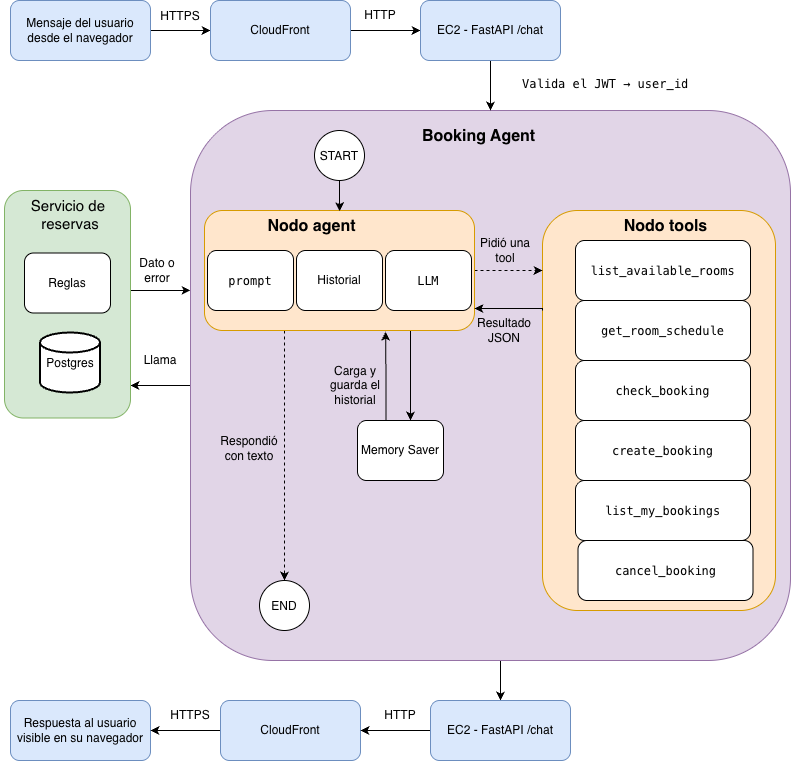

# Meeting Room Booking Assistant (Cubo Itaú)

A chatbot with tool calling that books meeting rooms A–E at the Cubo Itaú office. Built for the
Promtior technical challenge; not an official Cubo or Itaú product.

Live demo: https://d2bnvip7mwuw0n.cloudfront.net (`User1` or `User2`, password `TechnicalChallengePromtior`)

## Install

Requires Python 3.12, Docker and a free Groq API key (https://console.groq.com).

```bash
git clone https://github.com/Vic-bit/promtior-challenge.git
cd promtior-challenge
python3.12 -m venv .venv
source .venv/bin/activate        # Windows: .venv\Scripts\activate
pip install -r requirements-dev.txt
cp .env.example .env
```

In `.env`, set `GROQ_API_KEY` and a `JWT_SECRET` of at least 32 bytes
(`python -c "import secrets; print(secrets.token_hex(32))"`).

## Run

```bash
docker compose up -d db
uvicorn app.main:app --reload
```

Open http://localhost:8000 and log in. To run everything in containers instead:
`docker compose up -d --build` (served on http://localhost).

Tests: `pytest -m "not evals"` (the database must be running; no test calls the LLM).

## Using the assistant

Write in Spanish. Each request is handled by one of the agent's tools:

| Tool | Example message |
|---|---|
| `list_available_rooms` | ¿Qué salas hay libres mañana de 10 a 11 para 8 personas? |
| `get_room_schedule` | ¿Cómo está la agenda de la sala B el jueves? |
| `check_booking` + `create_booking` | Reservá la sala A mañana de 15 a 16 |
| `list_my_bookings` | ¿Qué reservas tengo? |
| `cancel_booking` | Cancelá mi reserva de la sala A |

Before creating or cancelling, the assistant asks for any missing data (title, attendees) and waits
for confirmation. Bookings use 30-minute slots, last up to 3 hours and are allowed Monday to Friday,
08:00–18:00.

## How it works

From the user's question to the assistant's answer:



## Documentation

- [doc/project_overview.md](doc/project_overview.md): approach, implementation logic and main challenges.
- [doc/component_diagram.png](doc/component_diagram.png): components from the question to the answer.
- [doc/technologies.ipynb](doc/technologies.ipynb): the technologies used, with code from the project.

---

Victor David Silva
